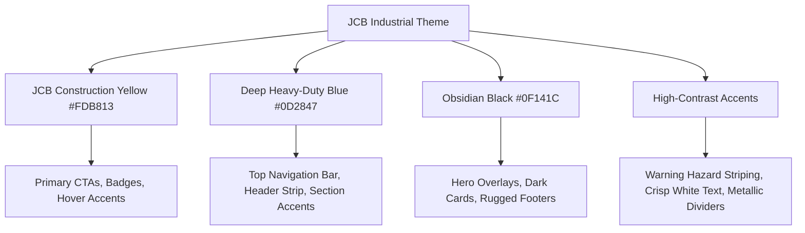

# Implementation Plan: Harisang Enterprises in Next.js

## 1. Project Overview & Objectives
The goal of this project is to faithfully recreate the **Harisang Enterprises** equipment rental and heavy-lifting website ([harisangenterprises.in](https://harisangenterprises.in/)) as a high-performance, mobile-responsive, production-grade **Next.js** application.

### Key Custom Requirements
1. **Frontend-Only Architecture**: Zero external database or complex backend required. Lead generation, interactive popups, and analytics operate purely on the frontend.
2. **JCB Industrial Color Theme**: Modern, rugged, and premium visual styling blending:
   - **JCB Construction Yellow** (`#FDB813` / `#E5A812`)
   - **Deep Industrial Blue** (`#0D2847` / `#1E3A8A`)
   - **Obsidian & Slate Black** (`#0F141C` / `#1A202C` / `#111827`)
   - Crisp white typography, caution stripes, subtle metallic accents, and high-visibility CTA buttons.
3. **Secret Traffic Analytics Page (`/admin/traffic`)**:
   - Protected by a client-accessible secret key (`NEXT_PUBLIC_ADMIN_SECRET`).
   - Tracks site visits, unique visitors, device types, referrers, and conversion clicks (Call Now, WhatsApp, Callback inquiries).
   - Features visual KPI metric cards, traffic graphs, conversion breakdown, and exportable data (CSV/JSON), stored purely in browser storage.
4. **Local Assets Utilization**: Uses the 11 provided heavy-machinery images in `assets/` and the official logo.

---

## 2. Technical Stack Specification

| Component | Technology | Purpose / Configuration |
|---|---|---|
| **Framework** | Next.js 14+ (App Router) | Fast SSG/SSR, optimized routing, and SEO |
| **Language** | TypeScript (Strict Mode) | Type-safe data structures and props |
| **Styling** | Tailwind CSS + Custom CSS | JCB design system tokens, responsive utilities, caution hazard patterns |
| **Icons** | Lucide React | High-performance industrial & contact icons |
| **Images** | Next.js `next/image` | Responsive image optimization, WebP delivery, zero layout shift |
| **Lead Flow** | Direct WhatsApp & Tel Links | Deep links with prefilled equipment quotes + Callback modal |
| **Analytics Engine** | Frontend Analytics Engine (LocalStorage/IndexedDB) | Zero-backend visitor & conversion event tracking |
| **Validation** | Native regex / lightweight schema | 10-digit Indian phone number validation |

---

## 3. Asset Inventory & Mapping

We audited the files in the workspace `assets/` folder and verified the live website structure. Here is the mapped asset roster:

| File Name | Size | Resolution / Orientation | Mapped Section | Target Usage |
|---|---|---|---|---|
| `logo.png` | ~15 KB | Transparent PNG | Header & Footer | Harisang Enterprises brand logo |
| `Crane.jpeg` | 31.7 KB | Landscape | Services Card 1 | **Crane on hire** |
| `Roadroller.jpeg` | 63.3 KB | Landscape | Services Card 2 | **Road Roller on hire** |
| `JCB.jpeg` | 190.2 KB | Landscape | Services Card 3 | **JCB on hire** |
| `JCBcrane.jpeg` | 239.8 KB | Landscape | Services Card 4 | **Poclain on hire** / Crawler Crane |
| `Forklist.jpeg` | 184.5 KB | Landscape | Services Card 5 | **Forklift on hire** |
| `Truck.jpeg` | 311.7 KB | Landscape | Services Card 6 | **Truck Trailer on hire** |
| `Forklift-crane.jpeg` | 163.1 KB | Landscape | Services Card 7 | **Hydra crane on hire** |
| `Crane2.jpeg` | 164.3 KB | Landscape | Services Card 8 | **Farana crane on hire** / Hero Slide 1 |
| `JCB2.jpeg` | 69.3 KB | Landscape | Hero Slider & Gallery | Hero Slide 2 / Gallery Grid |
| `Roadroller2.jpeg` | 47.7 KB | Landscape | Hero Slider & Gallery | Hero Slide 3 / Gallery Grid |
| `Forklist2.jpeg` | 133.6 KB | Landscape | Hero Slider & Gallery | Hero Slide 4 / Gallery Grid |

---

## 4. Theme & Design System (JCB Industrial Palette)



### Color Variables
- **JCB Primary Yellow**: `#FDB813` (`tw: jcb-yellow`)
- **JCB Yellow Dark/Hover**: `#E09E07` (`tw: jcb-yellow-dark`)
- **Industrial Navy Blue**: `#0D2847` (`tw: jcb-blue`)
- **Industrial Cobalt**: `#1B4474` (`tw: jcb-blue-light`)
- **Obsidian Black**: `#0F141C` (`tw: jcb-dark`)
- **Charcoal Surface**: `#1C2331` (`tw: jcb-card`)
- **Caution Stripe**: 45-degree alternating `#FDB813` and `#111827` hazard striping accent line under section headings.

---

## 5. Website Architecture & Component Hierarchy

```
harisang-Enterprises/
├── public/
│   ├── assets/
│   │   ├── logo.png
│   │   ├── services/       # Crane, Roadroller, JCB, Forklift, etc.
│   │   ├── hero/           # Hero slider slides
│   │   └── gallery/        # High-res gallery images
│   └── favicon.ico
├── src/
│   ├── app/
│   │   ├── layout.tsx      # Root HTML, SEO meta tags, font loader, tracker script
│   │   ├── page.tsx        # Homepage (single-page architecture)
│   │   ├── globals.css     # Tailwind directives, animations & hazard stripes
│   │   └── admin/
│   │       └── traffic/
│   │           └── page.tsx # Secret password-protected traffic analytics page
│   ├── components/
│   │   ├── layout/
│   │   │   ├── ContactBar.tsx     # Top contact bar (Phone, Email, Quick CTA)
│   │   │   ├── Header.tsx         # Logo, Nav items, Mobile hamburger
│   │   │   ├── MobileNav.tsx      # Slide-out drawer with quick actions
│   │   │   └── Footer.tsx         # Industrial footer, links, contact, copyright
│   │   ├── sections/
│   │   │   ├── HeroSlider.tsx     # Full-width carousel with controls & CTAs
│   │   │   ├── ServicesSection.tsx# 8 equipment cards in responsive grid
│   │   │   ├── ServiceCard.tsx    # Card with "From Mumbai" badge, Call & WhatsApp
│   │   │   ├── GallerySection.tsx # Responsive 10-image gallery grid
│   │   │   ├── LightboxModal.tsx  # Fullscreen image viewer with keyboard nav
│   │   │   └── ContactSection.tsx # Address card, direct dial, map link, social links
│   │   ├── ui/
│   │   │   ├── GetACallModal.tsx  # Quick inquiry popup (auto-trigger / on-click)
│   │   │   ├── FloatingWhatsApp.tsx# Sticky bottom-right WhatsApp quick chat button
│   │   │   └── BackToTop.tsx      # Smooth scroll-to-top button
│   │   └── analytics/
│   │       ├── AnalyticsProvider.tsx # Client-side visitor session & event logger
│   │       └── TrafficDashboard.tsx  # Admin dashboard cards, graphs & data tables
│   ├── data/
│   │   ├── servicesData.ts # Typed 8 equipment categories & images
│   │   ├── galleryData.ts  # Typed gallery images & captions
│   │   └── siteConfig.ts   # Contact info, phone, email, address, WhatsApp
│   ├── lib/
│   │   ├── analytics.ts    # Frontend analytics engine (storage, sessions, events)
│   │   └── utils.ts        # Helper functions
│   └── types/
│       └── index.ts        # Service, GalleryImage, TrafficEvent types
├── .env.example
├── .env.local
├── package.json
└── tailwind.config.ts
```

---

## 6. Detailed Section Specifications

### A. Contact Bar & Sticky Header
- **Top Bar**: Deep industrial blue background (`#0D2847`), highlighting:
  - Phone: `+91 9987003674` (clickable `tel:` link)
  - Email: `Harisangenterprises@gmail.com` (clickable `mailto:` link)
  - "Get A Call" trigger button.
- **Main Header**: Sticky on scroll, displaying the Harisang Enterprises logo, navigation anchors (`Home`, `Our Services`, `Gallery`, `Contact Us`), and responsive mobile drawer toggle.

### B. Industrial Hero Slider
- 4-slide automatic & manual carousel with JCB yellow slide indicators and previous/next arrows.
- High-contrast text overlay with headline:
  - *"India’s Leading End-to-End Crane & Heavy Equipment Rental"*
  - Subhead: *"Specialized Heavy Lifting, Poclain, JCB, and Hydra Crane Solutions Across Mumbai & Maharashtra"*.
- Action CTAs: **"View Equipment"** (`#package`) and **"Quick Call"** (`tel:+919987003674`).

### C. Services Catalogue (8 Equipment Cards)
Rendered in a 3-column desktop / 2-column tablet / 1-column mobile grid:
1. **Crane on hire**
2. **Road Roller on hire**
3. **Jcb on hire**
4. **Poclain on hire**
5. **Forklift on hire**
6. **Truck Trailer on hire**
7. **Hydra crane on hire**
8. **Farana crane on hire**

Each card contains:
- Category image with subtle zoom on hover.
- **"From Mumbai"** badge in JCB yellow.
- Title with heavy-duty font styling.
- Dual action buttons:
  - **Call Now**: Initiates phone call + logs conversion.
  - **WhatsApp**: Opens WhatsApp chat with prefilled message:
    `"Hello Harisang Enterprises, I would like to inquire about renting [Equipment Name] in Mumbai."`

### D. Gallery & Lightbox
- Responsive grid showcasing 10 high-resolution images.
- Interactive lightbox supporting:
  - Next / Previous image navigation.
  - Keyboard controls (Escape to close, Left/Right arrow keys).
  - Image captions and zoom view.

### E. "Get A Call" Callback Modal
- Pops up cleanly with a smooth fade-in.
- 10-digit Indian phone number input with instant validation.
- Zero-backend submission:
  - Stores lead in local storage for admin review on the secret page.
  - Optionally redirects the user directly into a WhatsApp confirmation chat or displays instant success feedback.

### F. Industrial Footer & Contact Area
- Business Address: `7/1, Suresh Niwas, kisan nagar no. 2, road no. 16, wagle estate, Thane(West), Maharashtra - 400 604.`
- Direct links for phone, email, and Google Maps direction.
- Quick navigation links, gallery thumbnails, and copyright bar.

---

## 7. Secret Traffic Analytics Dashboard (`/admin/traffic`)

### How It Works (Frontend-Only Architecture)
1. **Security & Authentication**:
   - Access URL: `/admin/traffic`
   - Prompt/Login screen requiring an **Admin Secret Passcode**.
   - Validates against `process.env.NEXT_PUBLIC_ADMIN_SECRET`.
   - On successful entry, stores an authenticated session token in `sessionStorage` so the admin doesn't re-enter it constantly.
2. **Data Collection (Passive & Active)**:
   - Every visitor generates a session ID, recording timestamp, landing path, device type (Mobile/Tablet/Desktop), browser, and referrer.
   - Event tracking logs conversion clicks:
     - `CALL_CLICK` (User tapped phone dialer)
     - `WHATSAPP_CLICK` (User initiated WhatsApp chat)
     - `CALLBACK_SUBMIT` (User submitted phone number in modal)
     - `GALLERY_VIEW` (User enlarged gallery photos)
3. **Admin Dashboard Visuals**:
   - **Summary KPI Cards**: Total Page Views, Unique Visitors, Total Call Inquiries, Total WhatsApp Chats, Callback Leads.
   - **Recent Leads Table**: View submitted mobile numbers with timestamps.
   - **Device Breakdown**: Interactive visual progress bars (Mobile vs Desktop vs Tablet).
   - **Daily Traffic Chart**: Bar chart showing 7-day visitor volume.
   - **Action Controls**:
     - *Export CSV / JSON*: Download all recorded traffic and lead logs.
     - *Reset Analytics*: Clear data with safety confirmation.

---

## 8. Environment Configuration

Create `.env.local` and `.env.example`:
```bash
# Harisang Enterprises Configuration
NEXT_PUBLIC_SITE_URL=https://harisangenterprises.in
NEXT_PUBLIC_CONTACT_PHONE=+919987003674
NEXT_PUBLIC_CONTACT_EMAIL=Harisangenterprises@gmail.com
NEXT_PUBLIC_WHATSAPP_NUMBER=919987003674

# Secret Admin Passcode for /admin/traffic dashboard
NEXT_PUBLIC_ADMIN_SECRET=harisang2026admin
```

---

## 9. Implementation Phases & Milestones

```mermaid
gantt
    title Harisang Enterprises Implementation Schedule
    dateFormat  X
    axisFormat %s
    section Phase 1: Setup & Assets
    Init Next.js Project & Tailwind Config   :p1, 0, 1
    Asset Organization & Manifest Setup      :p2, 1, 2
    section Phase 2: Design & Layout
    JCB Theme Tokens & Global CSS            :p3, 2, 3
    Header, Sticky Nav, ContactBar & Footer  :p4, 3, 4
    section Phase 3: Core Sections
    Hero Slider & Responsive Carousel        :p5, 4, 5
    Services Catalogue & 8 Equipment Cards   :p6, 5, 6
    Gallery Grid & Fullscreen Lightbox       :p7, 6, 7
    section Phase 4: Lead Generation
    Get A Call Modal & WhatsApp Integration  :p8, 7, 8
    section Phase 5: Secret Analytics
    Frontend Analytics Tracker Engine        :p9, 8, 9
    Secret /admin/traffic Dashboard UI       :p10, 9, 10
    section Phase 6: QA & Verification
    Responsive Testing & Production Build    :p11, 10, 11
```



- **Phase 1: Project Initialization & Asset Staging**
  - Initialize Next.js App Router in the root directory with TypeScript and Tailwind CSS.
  - Install dependencies (`lucide-react`, `clsx`, `tailwind-merge`).
  - Copy and catalog all assets from `assets/` into `public/assets/`.
- **Phase 2: JCB Design System & Layout Foundation**
  - Configure `tailwind.config.ts` with custom JCB colors, hazard striping, and animations.
  - Build `ContactBar`, `Header`, `MobileNav`, and `Footer`.
- **Phase 3: Hero, Services & Gallery Sections**
  - Implement `HeroSlider` with autoplay, indicators, and CTA buttons.
  - Build `ServicesSection` and `ServiceCard` with typed data file `servicesData.ts`.
  - Implement `GallerySection` and `LightboxModal` with responsive grid.
- **Phase 4: Contact & Interactive Lead Modals**
  - Implement `ContactSection` with address, click-to-call, email, and social links.
  - Implement `GetACallModal` with phone validation and lead capture.
  - Add sticky `FloatingWhatsApp` button.
- **Phase 5: Secret Traffic Analytics & Dashboard**
  - Create `lib/analytics.ts` to log pageviews, sessions, and conversion clicks in `localStorage`.
  - Create `/admin/traffic` protected by `NEXT_PUBLIC_ADMIN_SECRET`.
  - Build comprehensive dashboard with KPI cards, device breakdown, and lead export.
- **Phase 6: Quality Assurance & Production Build**
  - Verify responsive behavior at 375px, 390px, 768px, 1366px, and 1440px.
  - Test all interactive links (`tel:`, `mailto:`, WhatsApp deep links, modal, lightbox).
  - Run `npm run build` and ensure zero TypeScript or ESLint errors.

---

## 10. Verification & Acceptance Criteria
- [ ] Next.js App Router compiles cleanly with strict TypeScript and no build warnings.
- [ ] JCB industrial theme (yellow `#FDB813`, industrial blue `#0D2847`, obsidian black `#0F141C`) faithfully applied across all components.
- [ ] All 8 equipment cards rendered accurately using provided local assets.
- [ ] 10-image gallery grid with interactive lightbox functioning on desktop and mobile.
- [ ] All `tel:` and `mailto:` links trigger correctly without broken destinations.
- [ ] WhatsApp CTAs initiate chats with prefilled inquiry messages.
- [ ] Secret `/admin/traffic` page properly prompts for passcode, validates against `NEXT_PUBLIC_ADMIN_SECRET`, and presents rich visitor analytics and leads without requiring a backend.
- [ ] Zero horizontal overflow across mobile (375px, 390px), tablet (768px), and desktop (1440px) viewports.
